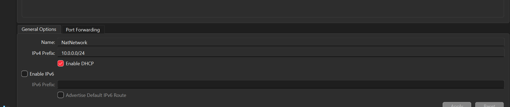
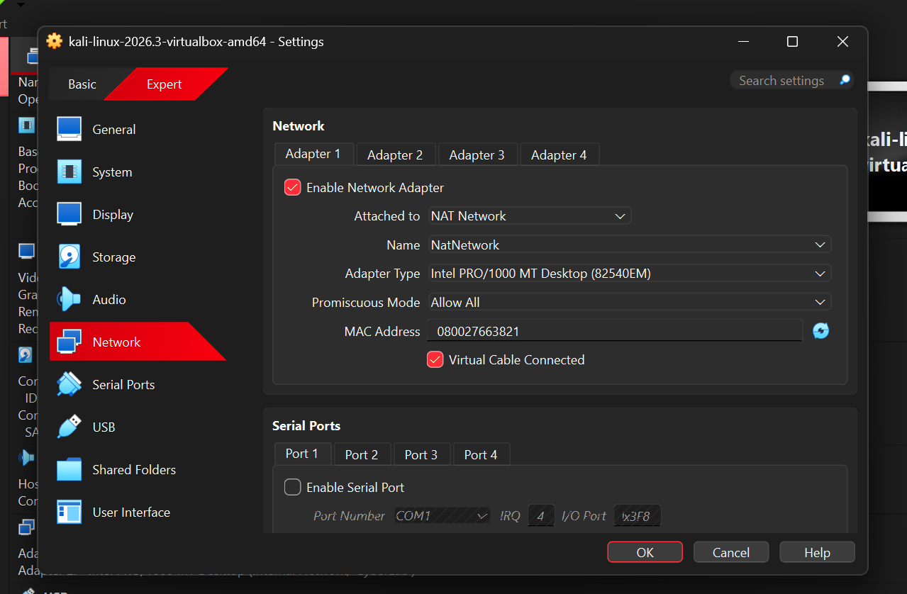
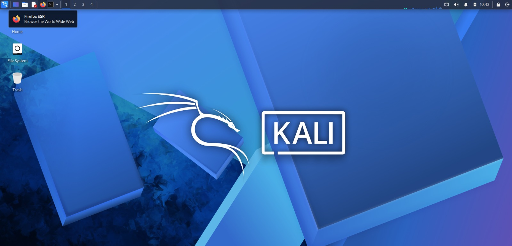
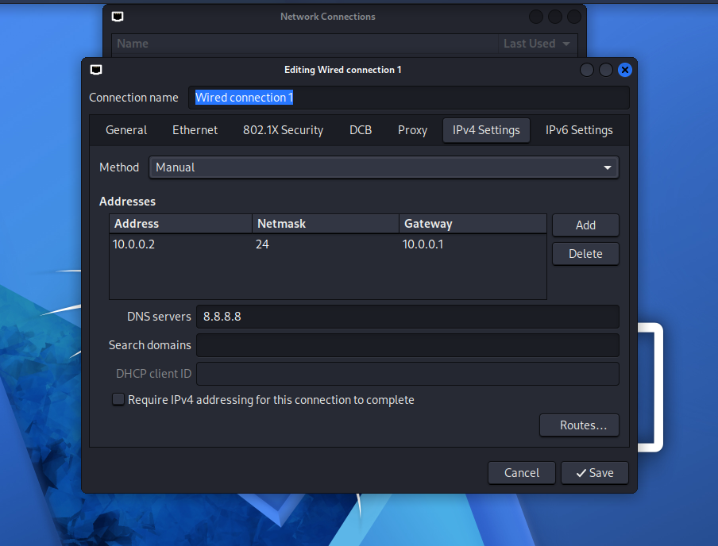

<h1 align="center">🐉 Cybersecurity Home Lab: Kali Linux on VirtualBox</h1>

<p align="center">
  <b>An isolated, snapshot-protected virtual lab for learning penetration testing safely.</b>
</p>

<p align="center">
  
  
</p>

<p align="center">
  
  
  
</p>

<p align="center">
  <a href="#-overview">Overview</a> ·
  <a href="#-architecture">Architecture</a> ·
  <a href="#-lab-setup">Setup</a> ·
  <a href="#-validation">Validation</a> ·
  <a href="#-troubleshooting">Troubleshooting</a> ·
  <a href="#-future-improvements">Roadmap</a>
</p>

---

## 📌 Overview

A virtualized cybersecurity home lab built on **VirtualBox**, with **Kali Linux** as the attacker machine. It provides a controlled environment for network scanning, reconnaissance, and vulnerability assessment, with no risk to the host computer or home network.

The lab uses a private **NAT Network**, so additional target machines can be added later for authorized testing.

## 🎯 Objectives

- Build a virtualized environment for cybersecurity learning and experimentation.
- Configure a private NAT Network for controlled connectivity and isolation.
- Install and configure Kali Linux with a consistent static IP address.
- Verify gateway, internet, and DNS connectivity.
- Create a clean baseline snapshot for fast recovery.
- Prepare the lab for future projects such as vulnerable targets and Active Directory.

---

## 🏗️ Architecture

The lab runs on a **[Windows 11]** host using VirtualBox. Kali Linux runs as a virtual machine attached to a dedicated NAT Network. Future target VMs will join the same network.

### Host Details

| Component | Specification |
|---|---|
| OS | [Windows 11 x64] |
| RAM | [16 GB] |
| Processor | [Intel Core i5] |
| Hypervisor | VirtualBox [7.x] |

### Virtual Machine Setup

| Virtual Machine | Role and Purpose | RAM | Storage | CPU | IP Address |
|---|---|---:|---:|---:|---|
| Kali Linux | Offensive security testing and vulnerability assessment | [2 GB] | [80 GB] | [2 cores] | `10.0.0.2` |
| *Target VM (planned)* | Vulnerable machine for practice | – | – | – | `10.0.0.3+` |

### Network Configuration

| Setting | Value |
|---|---|
| Network Type | NAT Network |
| Network Name | `NatNetwork` |
| Network Address | `10.0.0.0/24` |
| Default Gateway | `10.0.0.1` |
| DNS Server | `8.8.8.8` |
| DHCP | Enabled |
| IPv6 | Disabled |
| Planned Static Range for Future VMs | `10.0.0.3` – `10.0.0.99` *(lab convention)* |

### Kali Linux Network Settings

| Setting | Value |
|---|---|
| Adapter | Adapter 1 (enabled) |
| Attached To | NAT Network (`NatNetwork`) |
| Adapter Type | Intel PRO/1000 MT Desktop (82540EM) |
| Promiscuous Mode | Allow All |
| Virtual Cable | Connected |
| IPv4 Method | Manual (static) |
| IP Address | `10.0.0.2/24` |
| Gateway | `10.0.0.1` |
| DNS Server | `8.8.8.8` |

> **Note:** Storage values are configured virtual disk capacities, not actual host disk usage. Adjust RAM and CPU to match your host, and avoid running too many VMs at once.

---

## 🪜 Lab Setup

### 1. Install the Software

- Install [7-Zip](https://7-zip.org/download.html) to extract the Kali `.7z` archive.
- Install [VirtualBox](https://www.virtualbox.org/wiki/Downloads).
- Confirm hardware virtualization (Intel VT-x / AMD-V) is enabled in BIOS/UEFI.

### 2. Create the NAT Network

- Open VirtualBox and go to **Tools >> Network >> NAT Networks**.
- Click **Create** and configure it as shown below.

```yaml
Name:        NatNetwork
IPv4 Prefix: 10.0.0.0/24
DHCP:        enabled
IPv6:        disabled
```

<p align="center">
  
  <br>
  <sub><i>Figure 2: NatNetwork with prefix 10.0.0.0/24 and DHCP enabled</i></sub>
</p>

> **Why NAT Network?** A standard NAT isolates each VM. A NAT Network places VMs on the same private subnet so they can reach each other and still access the internet.

### 3. Import and Configure Kali Linux

- Download the official Kali VirtualBox image from [kali.org](https://www.kali.org/get-kali/).
- Import it into VirtualBox, then open **Settings >> Network >> Adapter 1** and apply these settings:

```yaml
Enable Network Adapter: checked
Attached to:            NAT Network
Name:                   NatNetwork
Adapter Type:           Intel PRO/1000 MT Desktop (82540EM)
Promiscuous Mode:       Allow All
Virtual Cable:          Connected
Memory:                 [2048] MB
Shared Folder:          disabled by default
```

<p align="center">
  
  <br>
  <sub><i>Figure 3: Kali Adapter 1 attached to NatNetwork</i></sub>
</p>

<p align="center">
  
  <br>
  <sub><i>Figure 4: Kali Linux running in VirtualBox</i></sub>
</p>

### 4. Configure the Static IP

In Kali, open **Network Connections >> Wired connection 1 >> IPv4 Settings** and set:

```yaml
Method:       Manual
IP Address:   10.0.0.2
Netmask:      24 (255.255.255.0)
Gateway:      10.0.0.1
DNS Servers:  8.8.8.8
```

<p align="center">
  
  <br>
  <sub><i>Figure 5: Kali static IP configuration</i></sub>
</p>

### 5. Create a Baseline Snapshot

Take a snapshot named **`Clean Kali - Network Ready`** before starting any experiments. If something breaks, restore it.

---

## ✅ Validation

Run these commands inside Kali to confirm the lab works:

```bash
ip a                  # confirm 10.0.0.2/24 is assigned
ip route              # confirm default route via 10.0.0.1
ping -c 4 10.0.0.1    # gateway reachable
ping -c 4 8.8.8.8     # internet reachable
nslookup google.com   # DNS working
nmap --version        # Nmap installed
```

| Check | Expected Result |
|---|---|
| IP address | `10.0.0.2/24` displayed |
| Gateway ping | 0% packet loss |
| Internet ping | 0% packet loss |
| DNS lookup | Domain resolves |
| Snapshot restore | VM returns to baseline |

  <br>
  <sub><i>Figure 6: Connectivity validation</i></sub>
</p>

---

## 🛠️ Troubleshooting

| Issue | Root Cause | Solution |
|---|---|---|
| VM fails to start (VT-x error) | Hardware virtualization disabled | Enable **VT-x / AMD-V** in BIOS/UEFI, save, and reboot |
| No internet after static IP | NetworkManager duplicate address detection delays the link | Disable DAD timeout (see below) |


```bash
nmcli connection show    # find your actual connection name first
sudo nmcli connection modify "Wired connection 1" ipv4.dad-timeout 0
sudo nmcli connection up "Wired connection 1"
```

> Connection names vary between systems. Always check yours before running the command.

---

## 🔐 Security Considerations

- **Shared Resources:** Keep shared folders and clipboard sharing disabled unless needed.
- **Network Isolation:** Use NAT Network or Host-Only networking. Avoid Bridged mode.
- **Snapshots:** Take a snapshot before major changes or risky tests.
- **Sensitive Data:** Never store personal or sensitive information in lab VMs.
- **Network Safety:** Confirm isolation before running tools that generate disruptive traffic.

## 💡 Key Takeaways

- A NAT Network supports multi-VM labs; plain NAT does not.
- Static IPs make a lab easier to document and script against.
- Snapshots are your safety net: take them before experimenting.
- Documenting problems and fixes makes the project reproducible.

## 🚀 Future Improvements

- [ ] **Vulnerable targets:** Add Metasploitable 2 or DVWA to the NAT Network.
- [ ] **Windows targets:** Add Windows 10/11 and Windows Server for Active Directory practice.
- [ ] **Docker:** Deploy vulnerable apps in containers instead of full VMs.
- [ ] **Host isolation:** Restrict VM-initiated access to the host.
- [ ] **Monitoring:** Add a SIEM or log-collection VM.

## ⚖️ Lab Safety

- Test only systems you own or have written permission to test.
- Keep vulnerable services inside the lab network.
- Verify isolation before running potentially disruptive tests.
- Take snapshots before major changes or risky experiments.

---

## 📁 Repository Structure

```text
.
├── README.md
└── screenshots/
    ├── 01-nat-network-configuration
    ├── 02-kali-network-adapterg
    ├── 03-kali-ip-configuration
    └── 04-kali-Linux
```

## 👤 Author

**[MD TAUSHIF IQBAL ]**: [Cybersecurity Student]
[](https://www.linkedin.com/in/md-taushif-iqbal-7ba538410//)
[](https://github.com/taushifiqbal786-png)
